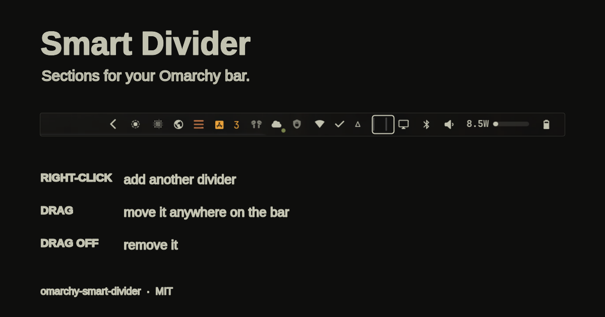

# Smart Divider

A thin, theme-aware vertical rule for the Omarchy bar — built to carve the bar
into sections. Right-click a divider to add another, then drag each one
wherever you want it.



## Why

The stock bar lays chips out in one long run. A divider makes the groups
readable: system, network, media, power, and so on. This plugin makes dividers
cheap to create and easy to rearrange, without adding a new plugin id for every
line. Unlike a divider that you add repeatedly from settings, right-clicking
the one in front of you duplicates it in place.

## Features

- **Right-click to duplicate.** A new divider appears immediately after the one
  you clicked.
- **Independent placement.** Every divider is its own bar layout entry, so the
  bar's normal left-drag moves each one separately.
- **Drag off to remove.** Pull a divider off the bar and it disappears.
- **Follows the theme.** The rule uses the current bar foreground colour and
  opacity, with a slight brighten on hover.
- **Remembers its place.** Each copy gets a stable `dividerId` in its layout
  entry, so duplicating always puts the new rule beside the one you clicked.

## Requirements

- Omarchy 4 (Quattro) with `omarchy-shell`
- `bash`
- `jq`
- `flock` (util-linux)

No network access, background polling, or external services.

## Installation

Install from the marketplace, or directly from this repository:

```bash
omarchy plugin add https://github.com/nikhill-666/omarchy-smart-divider.git --enable
```

Then add a divider from the bar settings, or place one yourself:

```bash
omarchy plugin enable io.github.nikhill-666.divider --after omarchy.workspaces
```

Once one divider is on the bar, right-click it for as many more as you need.

## Usage

| Action | Result |
| --- | --- |
| Right-click a divider | Adds another divider directly after it |
| Left-drag a divider | Moves it anywhere on the bar |
| Drag a divider off the bar | Removes it |

The divider is intentionally not a button: a plain left-click does nothing, so
it never steals the drag gesture from the bar.

## How it works

A divider is an ordinary `bar-widget` layout entry:

```json
{ "id": "io.github.nikhill-666.divider", "dividerId": "divider-…" }
```

`omarchy bar put` deliberately refuses to add a second copy of a widget, and a
bar-widget plugin cannot write `bar.layout` through the shell API. So
`duplicate-divider.sh`:

1. Finds the clicked entry by its `dividerId` (and gives every older, untagged
   divider a stable id on the first duplicate).
2. Clones that entry immediately after itself, preserving any custom settings.
3. Writes `~/.config/omarchy/shell.json` atomically with `jq`, then asks
   `omarchy-shell` to reload the config.

The plugin edits only `~/.config/omarchy/shell.json`. It does not overwrite any
other user configuration, and it makes no network requests.

## Removal

Remove any extra dividers first (drag them off the bar), then remove the plugin:

```bash
omarchy plugin remove io.github.nikhill-666.divider
```

If layout entries remain after removal, delete them from
`~/.config/omarchy/shell.json` and run `omarchy-shell shell reloadConfig`.

## License

MIT — see [LICENSE](LICENSE).
